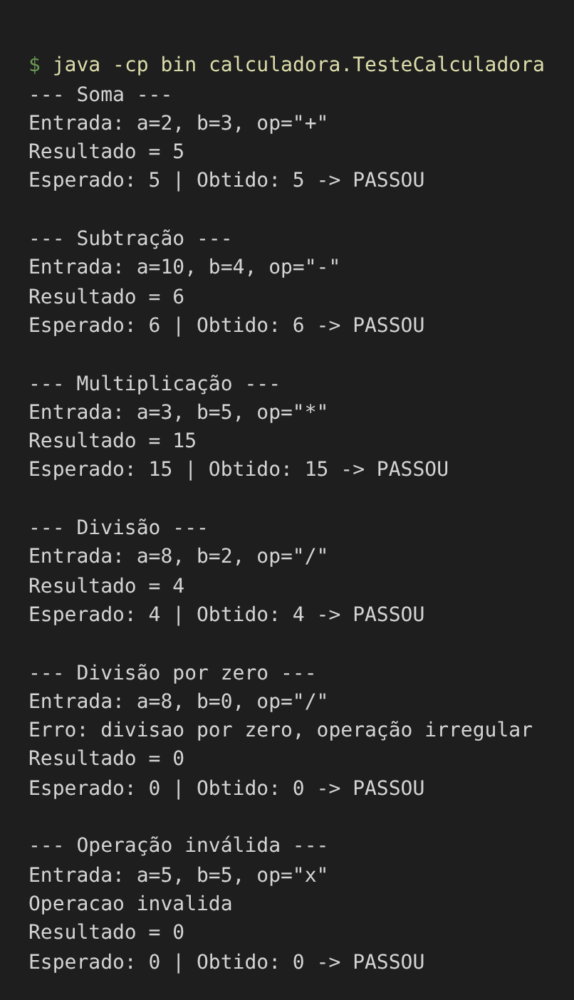

# Projeto Calculadora

**Projeto:** Projeto Calculadora

**Contexto:** FinançApp

**Aluno:** Bianca França Marques

**RA:** 250784

**Curso:** Análise e Desenvolvimento de Sistemas

**Disciplina:** UX/UI e Testes de Software

**Professor:** Daniel Ohata

**Semestre:** 2026.2

---

## Descrição do projeto

Módulo de cálculos matemáticos básicos em Java, criado para a startup fictícia **FinançApp**, que desenvolve um aplicativo mobile de controle de finanças pessoais. O módulo será usado em funcionalidades como cálculo de orçamento mensal, divisão de despesas, projeção de economia financeira e outros cálculos básicos do sistema.

> Esta é a **branch principal (`main`)**, com a **versão inicial** (Etapas 1 a 3). A versão refatorada e documentada está na branch **`Refatoracao`**.

## Objetivo da atividade

Desenvolver construção, validação, manutenção e documentação de software, aplicando conceitos de testes funcionais, testes unitários, tratamento de erros, refatoração de código, documentação técnica e versionamento de software.

## Tecnologias utilizadas

- Java (JDK 21)
- Visual Studio Code
- Git e GitHub
- JavaDoc (na branch `Refatoracao`)

## Estrutura do repositório

```
projeto_calculadora/
└── src/
    └── calculadora/
        ├── Calculadora.java
        └── TesteCalculadora.java
```

## Explicação das operações

O método `calc(int a, int b, String op)` recebe dois números inteiros e o operador, guarda o resultado no atributo `r` e **sempre retorna um `int`**.

| Operador | Operação      | Exemplo (a, b) | Resultado |
|----------|---------------|----------------|-----------|
| `+`      | Soma          | 2, 3           | 5         |
| `-`      | Subtração     | 10, 4          | 6         |
| `*`      | Multiplicação | 3, 5           | 15        |
| `/`      | Divisão       | 8, 2           | 4         |

**Tratamento de erros**

- **Divisão por zero** (`b == 0`): exibe a mensagem *"Erro: divisao por zero, operação irregular"* e retorna `0`, sem interromper o programa.
- **Operação inválida** (qualquer outro operador): exibe *"Operacao invalida"* e retorna `0`.

## Testes (Etapa 3)

A classe `TesteCalculadora` executa os 6 casos exigidos mostrando a entrada utilizada, o resultado esperado e o resultado obtido.

| Teste             | Entrada (a, b, op) | Esperado | Obtido | Status |
|-------------------|--------------------|----------|--------|--------|
| Soma              | 2, 3, `+`          | 5        | 5      | PASSOU |
| Subtração         | 10, 4, `-`         | 6        | 6      | PASSOU |
| Multiplicação     | 3, 5, `*`          | 15       | 15     | PASSOU |
| Divisão           | 8, 2, `/`          | 4        | 4      | PASSOU |
| Divisão por zero  | 8, 0, `/`          | 0 (erro) | 0      | PASSOU |
| Operação inválida | 5, 5, `x`          | 0 (erro) | 0      | PASSOU |

### Print da execução dos testes



### Como executar

```bash
cd projeto_calculadora
mkdir bin
javac -encoding UTF-8 -d bin src/calculadora/*.java
java -cp bin calculadora.TesteCalculadora
```

## Link do repositório

https://github.com/biancamarqueesss/UX-UI-TAREFA_INDIVIDUAL-BIANCA_MARQUES.git
