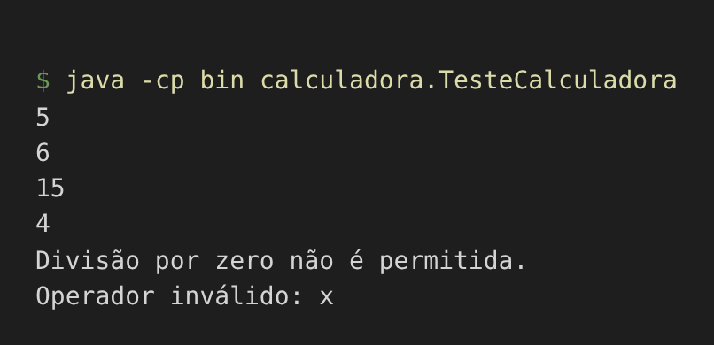
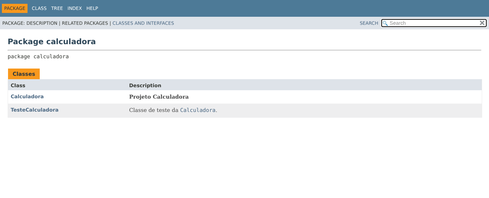
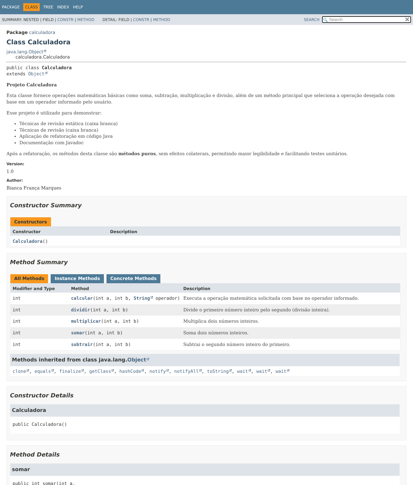

# Projeto Calculadora

**Projeto:** Projeto Calculadora

**Contexto:** FinançApp

**Aluno:** Bianca França Marques

**RA:** 250784

**Curso:** Análise e Desenvolvimento de Sistemas

**Disciplina:** UX/UI e Testes de Software

**Professor:** Daniel Ohata

**Semestre:** 2026.2

---

## Descrição do projeto

Módulo de cálculos matemáticos básicos em Java, criado para a startup fictícia **FinançApp**, que desenvolve um aplicativo mobile de controle de finanças pessoais. O módulo será usado em funcionalidades como cálculo de orçamento mensal, divisão de despesas, projeção de economia financeira e outros cálculos básicos do sistema.

> Esta é a branch **`Refatoracao`**: código refatorado, testes atualizados, JavaDoc e documentação HTML (Etapas 4 a 6). A versão inicial (Etapas 1 a 3) está na branch **`main`**.

## Objetivo da atividade

Desenvolver construção, validação, manutenção e documentação de software, aplicando conceitos de testes funcionais, testes unitários, tratamento de erros, refatoração de código, documentação técnica e versionamento de software.

## Tecnologias utilizadas

- Java (JDK 21)
- Visual Studio Code
- Git e GitHub
- JavaDoc

## Estrutura do repositório

```
.
├── README.md
├── prints/                      <- prints usados neste README
└── projeto_calculadora/
    ├── src/calculadora/
    │   ├── Calculadora.java
    │   └── TesteCalculadora.java
    └── docs/                    <- JavaDoc gerado (abrir docs/index.html)
```

## Explicação das operações

O método `calcular(int a, int b, String operador)` escolhe a operação pelo operador e delega para um método específico. Todos retornam um `int`.

| Operador | Método         | Operação      | Exemplo (a, b) | Resultado |
|----------|----------------|---------------|----------------|-----------|
| `+`      | `somar`        | Soma          | 2, 3           | 5         |
| `-`      | `subtrair`     | Subtração     | 10, 4          | 6         |
| `*`      | `multiplicar`  | Multiplicação | 3, 5           | 15        |
| `/`      | `dividir`      | Divisão       | 8, 2           | 4         |

**Tratamento de erros**

- **Divisão por zero** (`b == 0`): lança `IllegalArgumentException` com a mensagem *"Divisão por zero não é permitida."*.
- **Operador inválido**: lança `IllegalArgumentException` com a mensagem *"Operador inválido: x"*.
- No `TesteCalculadora` as exceções são capturadas com `try/catch`, então o programa não é interrompido.

## Refatoração (Etapa 4)

| Técnica aplicada                  | Antes (`main`)                              | Depois (`Refatoracao`)                                   |
|-----------------------------------|---------------------------------------------|----------------------------------------------------------|
| Extração de métodos               | Tudo dentro de `calc`                       | `somar`, `subtrair`, `multiplicar`, `dividir`, `calcular` |
| Simplificação de condicionais     | Cadeia de `if / else if` aninhada           | `switch` com um caso por operador                         |
| Melhoria de nomes                 | `calc`, `op`, `r`                           | `calcular`, `operador`, retorno direto                    |
| Métodos puros (sem efeito colateral) | Atributo `r` e `System.out.println` no método | Métodos só calculam e retornam; erros viram exceções      |
| Organização lógica                | Cálculo, validação e mensagem misturados    | Cada método tem uma única responsabilidade                |

Após a refatoração os testes foram executados novamente e o funcionamento permaneceu correto.

### Resultado esperado x obtido

| Chamada                    | Esperado                          | Obtido                              |
|----------------------------|-----------------------------------|-------------------------------------|
| `calcular(2, 3, "+")`      | 5                                 | 5                                   |
| `calcular(10, 4, "-")`     | 6                                 | 6                                   |
| `calcular(3, 5, "*")`      | 15                                | 15                                  |
| `calcular(8, 2, "/")`      | 4                                 | 4                                   |
| `calcular(8, 0, "/")`      | exceção                           | Divisão por zero não é permitida.   |
| `calcular(5, 5, "x")`      | exceção                           | Operador inválido: x                |

### Print da execução dos testes (branch Refatoracao)



### Como executar

```bash
cd projeto_calculadora
mkdir bin
javac -encoding UTF-8 -d bin src/calculadora/*.java
java -cp bin calculadora.TesteCalculadora
```

## Documentação JavaDoc (Etapas 5 e 6)

Classes, métodos, parâmetros, retornos e exceções estão documentados com `@author`, `@version`, `@param`, `@return` e `@throws`. A documentação HTML está em [`projeto_calculadora/docs/index.html`](projeto_calculadora/docs/index.html) (baixe o repositório e abra o arquivo no navegador).





Para gerar novamente:

```bash
cd projeto_calculadora
javadoc -encoding UTF-8 -docencoding UTF-8 -charset UTF-8 -author -version -d docs -sourcepath src calculadora
```

## Link do repositório

https://github.com/biancamarqueesss/UX-UI-TAREFA_INDIVIDUAL-BIANCA_MARQUES.git
